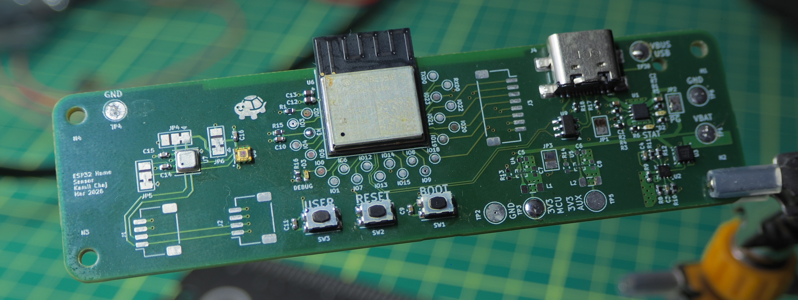
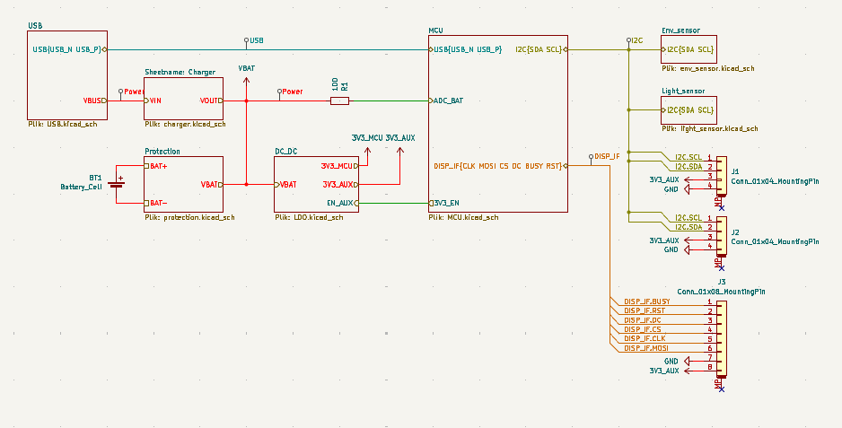
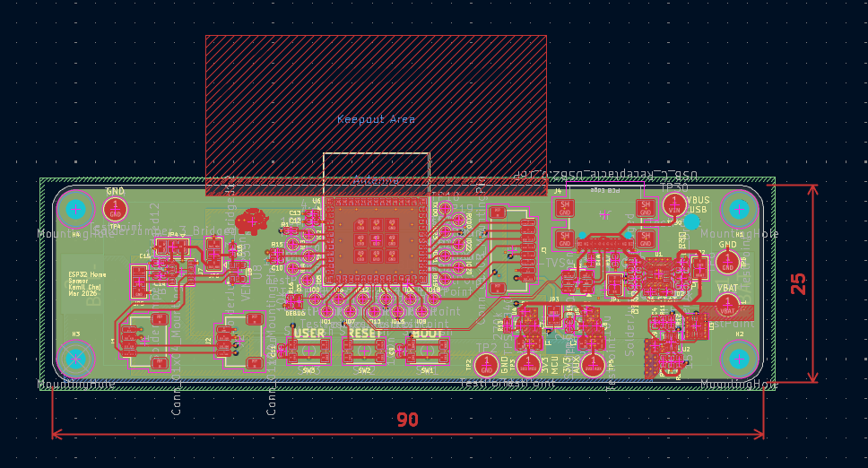
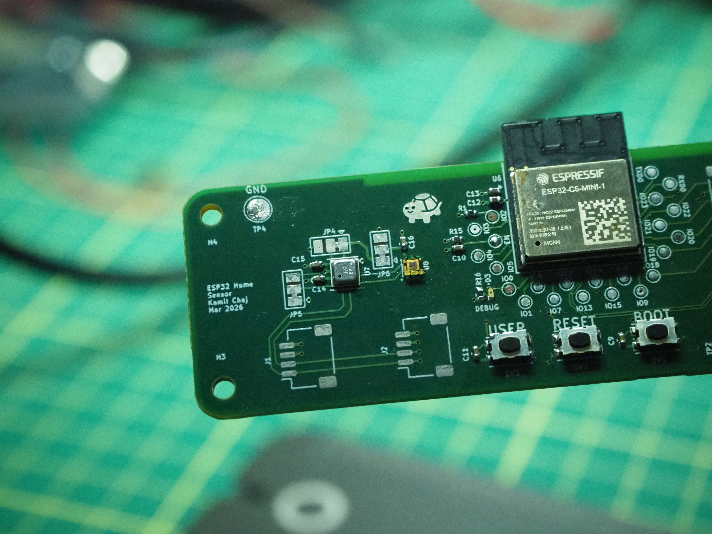
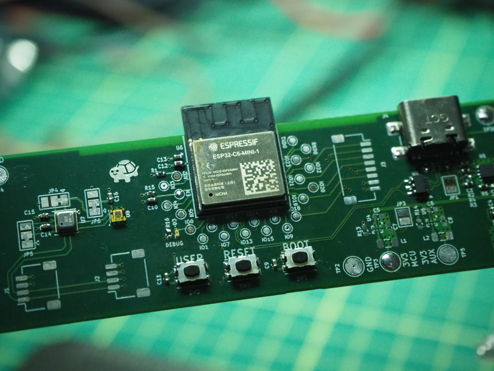
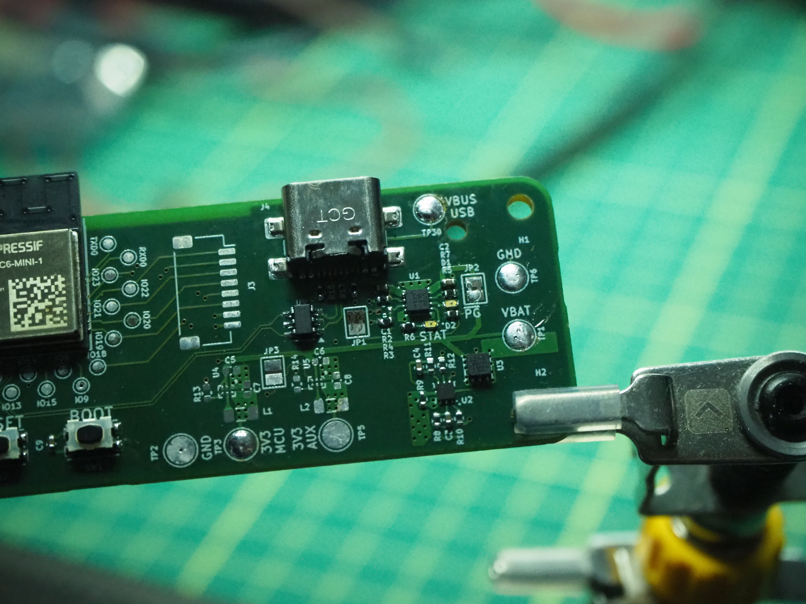
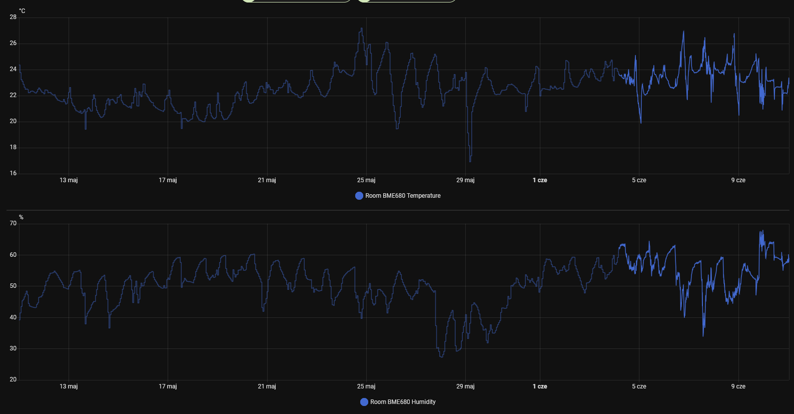

# ESP home sensor

Embedded electronics and avionics project

Kamil Chaj 418269

<figure style="text-align:center;">
	
	<figcaption>Complete PCB assembly</figcaption>
</figure>

KiCAD project files and ESPHome config can be found in [this repository](https://github.com/kamilix2003/esp-home-sensor).

## Description

Wireless ESP32-C6 based home environmental sensor powered by single Li-ion 18650 cell, running ESP home firmware optimized for battery life which is to be measured in months instead of days. The project is also a learning experience in designing with smaller package sizes and no exposed leads or pads.

## Requirements

- Li-ion cell protection and charger circuits
- Environmental sensor: Temperature, Humidity, CO2, Volatile gases
- Light sensor
- Battery voltage monitoring
- Expansion connectors: other sensors, e-ink display
- Low power consumption during deep sleep

## Hardware

### Component selection

Components were selected based on requirements listed above in [Requirements](#requirements) section as well as availability, package size and ESP Home compatibility.

- Espressif **ESP32-C6-MINI-1** - Wireless MCU
- Ti **BQ2970** - Cell protector with an Integrated High-Side NFETDriver
- Infineon **IRLHS6276TRPBF** - Dual N-type MOSFET
- Ti **BQ25170** - Li-ion cell charger
- Ti **TPS62840** - DC/DC converter
- Bosch **BME680** - integrated environmental sensor
- Vishay **VEML3235** - digital light sensor

Package sizes and types were selected smaller than required as I wanted to try assembly of components with no exposed leads or pads (i.e., LGA and BGA).

<figure style="text-align:center;">
	
	<figcaption>System schematic</figcaption>
</figure>

### Layout

The PCB was designed and manufactured on a 4-layer board, which allowed for easy routing of both signal and power. Standard GND/PWR stackup was utilized. Almost all components were placed on the top layer of the PCB, with only a single thermistor and 18650 cell cage on the bottom layer. Multiple test points were added for easier measurements and debugging.

<figure style="text-align:center;">
	
	<figcaption>PCB layout</figcaption>
</figure>

---

### Assembly

The board was hand soldered using hot air soldering and a hot plate for LGA components.

	<figure style="max-width:600px;width:32%;margin:0;">
		
		<figcaption style="text-align:center;">Sensor section</figcaption>
	</figure>
	<figure style="max-width:600px;width:32%;margin:0;">
		
		<figcaption style="text-align:center;">MCU section</figcaption>
	</figure>
	<figure style="max-width:600px;width:32%;margin:0;">
		
		<figcaption style="text-align:center;">Power section</figcaption>
	</figure>

Unfortunately, the BGA DC/DC converters were not assembled correctly and were left unpopulated. For board bring-up purposes, an external 3V3 supply was used.

First assembly was done with use of only hot air soldering, which did not yield good results for LGA components, connections on ESP32-C6 were not reliable and JTAG via USB was not working. After reflowing the board on a hot plate, connections were more reliable and JTAG was working.

The battery charger and protection circuits were not fully tested. There appears to be a major issue with the battery protection circuit, as power was not cut during under-voltage and over-voltage testing with a bench power supply.

## ESPHome Configuration

Initial ESPHome was set up on a Seeed Studio XIAO ESP32S3 development board with a BME680 breakout board before assembly of the final board. This successfully connected to Home Assistant and reported sensor readings.

<figure style="text-align:center;">
	
	<figcaption>ESPHome sensor readings</figcaption>
</figure>

After assembly of the final board and successful JTAG connection, ESPHome was configured for the new hardware and successfully flashed. However, due to I2C bus issues, none of the sensors were working, and only battery voltage measurement functioned. After extensive debugging, JTAG connectivity became unreliable and the board could not connect to Home Assistant. It is suspected that the power supply is the issue, as an older bench power supply may have overshot the voltage during power-up and damaged the board.

## Results

The results of the project are not satisfactory, as the board is not working as intended and cannot reliably connect to Home Assistant. There are multiple issues with the board, including the battery protection circuit and I2C bus issues, which need to be addressed to achieve the desired functionality.

Component selection significantly contributed to the issues, as all components were selected in tiny packages with no exposed leads or pads, making assembly unreliable and error-prone.

## Conclusions

The project was a learning experience in embedded systems design. It highlighted the importance of iterative design and testing throughout development. For future revisions, I would consider prototyping subsystems on breadboards or development boards before designing the final PCB, selecting components to allow for easier assembly and debugging, and adding more test points and solder bridges.

### Improvements for second revision

Major issues:

- Review of battery protection and charging circuits
- I2C bus connectivity issues, adding place for external pull-up resistors and test points for easier debugging, also moving I2C bus pins away from pin 15, which is a strapping pin
- Re-evaluation of component selection, especially for DC/DC converter, possibly adding redundant LDO for the case of DC/DC converter failure.

Minor issues and improvements:

- Add more test points on the bottom layer and solder bridges for easier debugging
- Add board and copper cutout around the BME680 to reduce thermal mass and improve sensor readings
- Add an alternative battery connector option to the 18650 cell cage